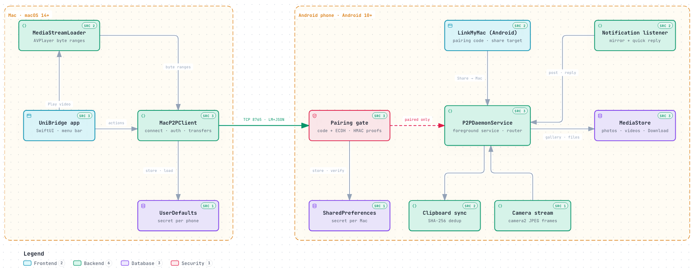

# LinkMyMac

**Apple-Continuity-style features between an Android phone and a Mac, with no cloud and no accounts.**

LinkMyMac connects a Mac and an Android phone directly, over your Wi-Fi network or a USB cable. Your phone's notifications show up on the Mac (and you can reply from there). The clipboard syncs both ways. You can browse, stream and download the phone's photos and videos, send files in either direction, and use the phone's camera on the Mac.

It's two apps that talk to each other:

| App | Folder | Built with |
|:---|:---|:---|
| **LinkMyMac Companion** (Android 10+) | `android-app/` | Kotlin, a foreground service, `NotificationListenerService`, MediaStore, camera2 |
| **UniBridge** (macOS 14+) | `macos-app/` | Swift 6, SwiftUI + AppKit, Network.framework, CryptoKit, AVKit |

[**Download the Android app (latest release)**](https://github.com/rohitrathia2/linkmymac/releases/latest) · [Wire protocol](protocol/WIRE_SPEC.md)

---

## Architecture

<picture>
  <source media="(prefers-color-scheme: dark)" srcset="docs/architecture-dark.png">
  
</picture>

How to read it, left to right:

- **On the Mac**, the SwiftUI app hands every action to `MacP2PClient`, which owns the connection: discovery, pairing, framing and file transfers. Video playback goes through `MediaStreamLoader`, which feeds AVPlayer byte ranges fetched from the phone. The pairing secret for each phone is kept in `UserDefaults`.
- **Between them** is one TCP connection to port 8765, carrying length-framed JSON messages.
- **On the phone**, every connection first meets the **pairing gate**. Until the Mac proves it holds the shared secret, the phone ignores everything else it sends. Only then does `P2PDaemonService` route requests to MediaStore (photos, videos, received files), the notification listener, clipboard sync and the camera.

The diagram is generated with [archify](https://github.com/tt-a1i/archify) from [`candidate.json`](.archify/architecture-linkmymac-20261115-135430/candidate.json). Every box links to the source lines it summarises. Open [`linkmymac.html`](.archify/architecture-linkmymac-20261115-135430/linkmymac.html) in a browser for the interactive version.

## Features

| Feature | Status | What it does |
|:---|:---|:---|
| **Notification mirroring + quick reply** | ✅ | Phone notifications appear as macOS banners and in the app. Reply inline or dismiss them from the Mac. |
| **Universal clipboard (text)** | ✅ | Copy on one device, paste on the other. SHA-256 dedup stops copies from echoing back and forth. |
| **Photos & Videos** | ✅ | Separate Photos and Videos sections, each paged and synced on its own. **Group by Folder** mirrors the phone's storage folders (Camera, Screenshots, WhatsApp…), with each folder collapsible. Download, share or delete from the Mac. |
| **Video streaming** | ✅ | **Play** starts after the first few hundred KB. AVPlayer fetches only the byte ranges it needs, so seeking is instant and nothing waits for a full download. |
| **File sharing, both ways** | ✅ | Mac → phone from the File Sharing tab, the Dock icon or the menu bar. Phone → Mac from **Share → LinkMyMac Companion** in any app, or **Send Files to Mac**. Any size, streamed in constant memory. |
| **Phone camera on the Mac** | ✅ in-app | Live view in the app, front/back lens flip, and a floating always-on-top window. To use it in video calls, see [below](#use-the-phone-camera-in-video-calls). |
| **Mac "Now Playing" on the phone** | ✅ | Control Mac media playback from a notification on the phone. |
| **Shared links/text → Mac clipboard** | ⚠️ partial | Lands on the Mac clipboard; nothing opens automatically. |
| SMS, calls, screen mirroring, mouse/keyboard sharing, hotspot | ❌ | Not built yet. |

## How it works

### Finding each other
- **Wi-Fi:** the phone advertises `_linkmymac._tcp` over Bonjour/mDNS, and the Mac connects to the first phone it finds. You can also type the phone's IP under QR Code Pairing → Manual IP.
- **USB:** run `adb forward tcp:8765 tcp:8765`, and the Mac connects to `127.0.0.1:8765`. On launch the Mac app reconnects to the last address it used, which is USB by default. USB traffic never touches the network.
- Every message is a frame: the bytes `LM`, a 2-byte flag, a 4-byte length, then a JSON object (16 MB max). See [WIRE_SPEC.md](protocol/WIRE_SPEC.md) for the full message list.

### Pairing and trust
1. On every connect, the phone speaks first with a fresh random **challenge**.
2. **First time:** the phone shows a **6-character, single-use code**. You type it on the Mac, or scan the phone's QR code. The Mac sends the code with a temporary P-256 key, and both sides derive a 256-bit secret via **ECDH**, so the secret itself never travels over the network. A wrong code blocks code attempts for 3 seconds.
3. **Every reconnect:** the Mac proves it has the secret with `HMAC(secret, challenge)`, and the phone proves it the same way. A recorded answer can't be replayed, and a fake device on the network can push nothing into the Mac.
4. **Revoking access:** "Forget Paired Macs" on the phone revokes every Mac. A Mac can also unpair just itself.

### Files, photos and videos
- **Files** go out as a `FILE_OFFER`, then 64 KB chunks, then a completion message. The sender waits for the connection to accept each chunk, so even multi-GB files use constant memory. The receiver checks chunk order and count, and deletes partial files.
  - Files arrive in **`~/Downloads`** on the Mac (never overwriting: `name (1).ext`).
  - On the phone they arrive in **`Download/LinkMyMac`**, with a notification you can tap to open the file.
- **The gallery** asks the phone for one page of photos or videos at a time, newest first, with thumbnails and folder information.
- **Video playback** uses an `AVAssetResourceLoaderDelegate`. AVPlayer asks for byte ranges (phone recordings keep the MP4 index at the end of the file, so it fetches the tail first), and each range becomes a request to the phone. Seeking or closing the player cancels ranges it no longer needs. Videos you've already downloaded play from the local file.

## Install

### Android
1. Download `LinkMyMac-Android-1.1.0.apk` from [Releases](https://github.com/rohitrathia2/linkmymac/releases/latest) and open it on the phone. Allow installing from your browser or file manager if asked.
2. If you previously installed a build from source (debug-signed), **uninstall it first**. Android won't update across different signing keys.
3. Open **LinkMyMac Companion** and grant **notification access** and **all-files access** when asked.

The bridge keeps running as a foreground service. It restarts by itself after app updates and reboots; on vivo, Xiaomi and similar phones, also allow **Autostart** for the app.

### macOS
There's no notarised build yet, so build it from source (Xcode 16+ or the Swift 6 toolchain, macOS 14+):
```bash
macos-app/bundle.sh     # builds LinkMyMac.app next to this README (release, ad-hoc signed)
open LinkMyMac.app
```
Because the app is ad-hoc signed, macOS may ask again for Local Network, Downloads and notification permission after each rebuild.

## Getting started
1. Start the phone app. For USB, also run `adb forward tcp:8765 tcp:8765`.
2. Start UniBridge on the Mac. It finds the phone over Wi-Fi or USB.
3. The Mac sidebar asks for a **pairing code**. Type the code shown in the phone app's status badge, or scan its QR code from the Mac's **QR Code Pairing** tab.
4. Done. Notifications, clipboard and the gallery start syncing. Send files from the **File Sharing** tab, and browse **Photos** or **Videos** (try **Group by Folder**).

## Use the phone camera in video calls
The phone camera doesn't register as a system webcam yet, so call apps can't list it directly. Use OBS as a bridge:
1. Install OBS Studio. In UniBridge, open **FaceTime Camera**, start the phone camera, and open the floating camera window.
2. In OBS, add **macOS Screen Capture → Window → the UniBridge camera window**, then click **Start Virtual Camera**. The first time, allow it under System Settings → General → Login Items & Extensions → Camera Extensions.
3. In the call, choose **OBS Virtual Camera** for the phone or **FaceTime HD Camera** for the Mac:
   - FaceTime: Video → Camera
   - Zoom: the ^ next to Stop Video
   - Meet: ⋮ → Settings → Video
   - Teams: … → Device settings
4. Flip between the phone's front and back lens with **Flip Lens** on the Mac or **Switch Lens** on the phone.

A native camera extension would make this one step; it needs a Developer ID–signed build.

## Security model
- **What's protected:** nothing flows until both sides prove the shared secret, and credentials never cross the wire in a reusable form. A device that merely shares your network can't read or control either side.
- **Not yet: transport encryption.** On Wi-Fi, someone on the same network can read notifications, clipboard text and files in transit, and an active attacker could hijack a session. **USB is not affected.** The fix is TLS with the phone's certificate pinned at pairing; the QR code already carries its fingerprint.

## Android permissions
| Permission | Why |
|:---|:---|
| Notification access, foreground service | The bridge itself |
| All-files access (`MANAGE_EXTERNAL_STORAGE`) | Only so **Delete from Mac** can remove photos/videos made by other apps. Google Play restricts this permission; a Play build would use `MediaStore.createDeleteRequest` instead. |
| Camera | Phone camera view |
| Start at boot (`RECEIVE_BOOT_COMPLETED`) | Restart the bridge after a reboot or update |
| Launcher `<queries>` | App names and icons for mirrored notifications (instead of `QUERY_ALL_PACKAGES`) |

No SMS, contacts or call permissions.

## Repository layout
```
android-app/src/main/java/com/linkmymac/android/
  crypto/PairingManager.kt        pairing code, ECDH, HMAC proofs
  service/P2PDaemonService.kt     TCP server, auth gate, files, byte-range streaming
  service/MediaStoreProvider.kt   photo/video pages, folders, delete
  service/LMMNotificationListener.kt, ClipboardSyncHelper.kt, CameraStreamProvider.kt
  service/AutoStartReceiver.kt    restart after reboot/update
  ui/MainActivity.kt              pairing code, share target, Send Files
macos-app/
  bundle.sh, Info.plist           build LinkMyMac.app
  Sources/LinkMyMac/
    LinkMyMacApp.swift            dashboard, Photos/Videos, File Sharing, preview player
    MacP2PClient.swift            discovery, connection, auth, transfers
    MediaStreamLoader.swift       AVPlayer byte-range streaming
    MacSubsystems.swift           clipboard watcher, notification banners
  Checks/StreamLoaderCheck.swift  headless streaming check
protocol/
  WIRE_SPEC.md                    framing, pairing, file and video messages
  e2e_check.py                    on-device protocol check
docs/                             architecture images
```

## Development

**Build**
- Android: `cd android-app && ./gradlew assembleDebug`
- Mac: `macos-app/bundle.sh` (or `cd macos-app && swift run` for quick iteration)

**Checks**
- **Phone protocol**, against a real phone over USB:
  ```bash
  adb forward tcp:8765 tcp:8765
  python3 protocol/e2e_check.py --code <code shown on the phone>
  ```
  This verifies the pairing gate (unpaired clients get nothing, wrong codes are rejected, retries are rate-limited, replays fail), photo/video paging, video streaming and a Mac → phone transfer. It unpairs its own test client at the end.
- **Mac video streaming**, with no phone needed: plays a synthetic MP4 over a throttled fake link and fails if playback waits for most of the file.
  ```bash
  cd macos-app && swiftc -parse-as-library Sources/LinkMyMac/MediaStreamLoader.swift \
      Checks/StreamLoaderCheck.swift -o .build/stream-check && .build/stream-check
  ```

**Releases**
- `./gradlew assembleRelease` signs with the keystore named in `android-app/keystore.properties` (git-ignored):
  ```
  storeFile=/absolute/path/linkmymac-release.jks
  storePassword=…
  keyAlias=linkmymac
  keyPassword=…
  ```
- Keep the keystore and its password backed up. Without them, future APKs can't update existing installs.
